# 🔱 Neptune AI — Autonomous Multi-Agent Trading Suite

> **Built for the NEAR Hackathon (October 2026)**
> All code from commit [`9bdf0b1`](https://github.com/TheDarrk/N-agent/commit/9bdf0b1) onward (Oct 23, 2026) was written **after the hackathon announcement**. The base project (Feb 2026) provided only a minimal NEAR wallet chat interface. Everything described in this README — the entire agent suite, all 4 autonomous agents, the marketplace, the redesigned dashboard, the RAG pipeline, the MCP suite, the multi-node architectures, structured outputs, decentralized storage, and all new chat features — was built from scratch during the hackathon window.

---

## 🏆 What We Built

Neptune AI transforms from a simple chat bot into a **fleet of 4 autonomous AI agents** that trade, research, rebalance, and govern each other — all running on NEAR Protocol with on-chain signing and verifiable reasoning traces.

**Live Demo:** [neptune-ai.vercel.app](https://neptune-ai.vercel.app)

---

## 📋 Table of Contents

1. [System Overview](#system-overview)
2. [The Agent Suite (Star Feature ⭐)](#the-agent-suite)
   - [🔬 Research Agent](#-research-agent)
   - [📈 Trader Agent](#-trader-agent)
   - [⚖️ Rebalancer Agent](#️-rebalancer-agent)
   - [🛡️ Moderator (Watchdog) Agent](#️-moderator-watchdog-agent)
3. [Agent Marketplace](#agent-marketplace)
4. [Autonomy Dashboard](#autonomy-dashboard)
5. [What's New in Chat](#whats-new-in-chat)
6. [RAG & Knowledge Base](#rag--knowledge-base)
7. [MCP Tool Suite](#mcp-tool-suite)
8. [Structured Outputs & System Prompt Design](#structured-outputs--system-prompt-design)
9. [Decentralized Storage & Audit Trails](#decentralized-storage--audit-trails)
10. [Security & Guardrails](#security--guardrails)
11. [Cross-Chain Architecture](#cross-chain-architecture)
12. [Tech Stack](#tech-stack)
13. [Quick Start](#quick-start)

---

## System Overview

Neptune AI is a decoupled full-stack application where users keep their primary wallet safe while delegating a **budget wallet** to the AI fleet.

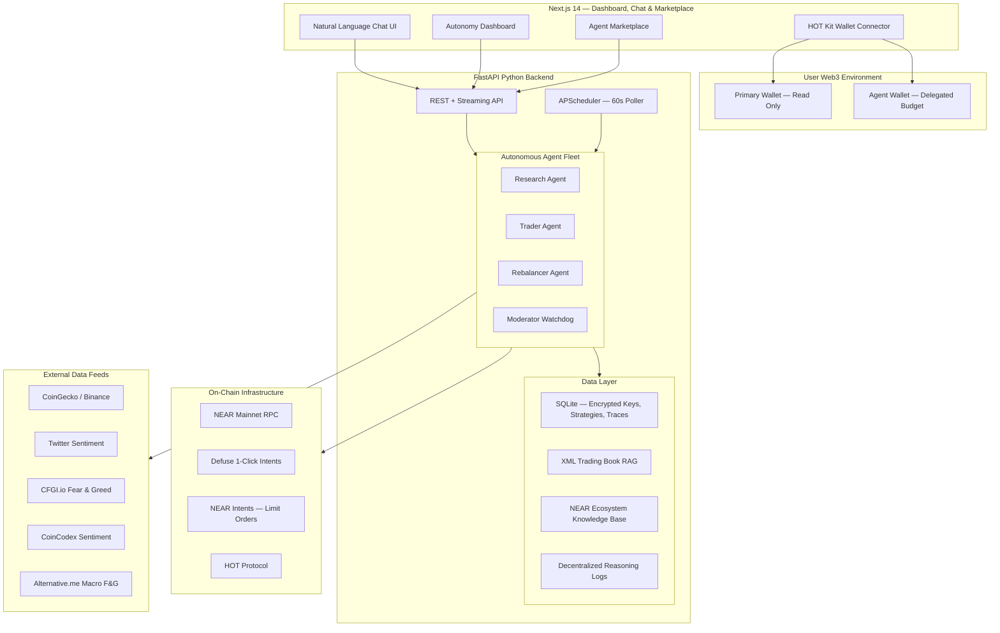

### The Delegate Signer Model

Neptune **never touches your primary wallet**. Instead:

1. User funds a separate Agent Wallet with a trading budget
2. User adds a full-access key **strictly scoped to that agent wallet** via MyNearWallet or Meteor
3. Neptune encrypts and stores that key in SQLite (AES-256)
4. All autonomous trades are signed with that key — primary wallet is read-only

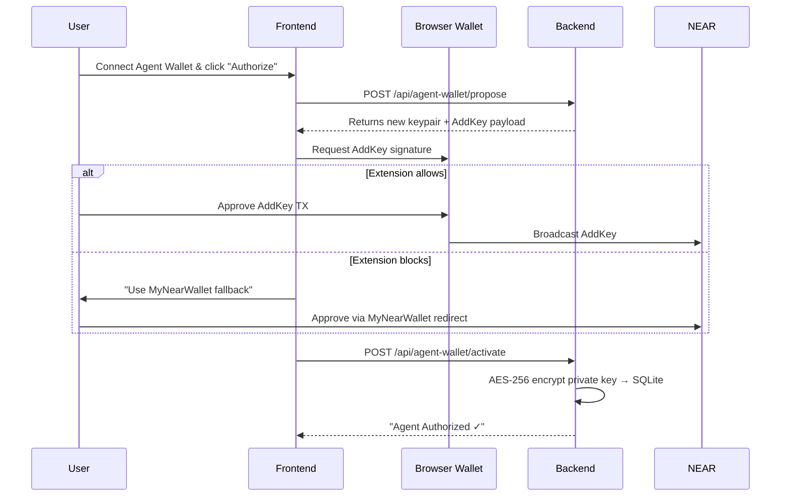

---

## The Agent Suite

> ⭐ **This is our star feature.** Four specialized autonomous agents, each with a multi-node architecture, run independently and cross-audit each other. Every decision is reasoned in structured JSON, grounded in evidence, and stored as a verifiable audit trace.

---

### 🔬 Research Agent

**File:** [`ai-agent-backend/autonomous_agents/research_agent.py`](ai-agent-backend/autonomous_agents/research_agent.py)

The Research Agent is a **3-Node institutional research pipeline** that produces citation-grounded reports on any NEAR ecosystem topic.

#### Architecture: 3-Node Pipeline

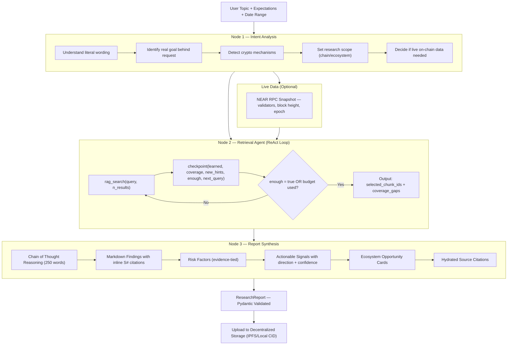

#### What Context Each Node Carries

| Node | Context Received | Context Produced |
|------|-----------------|-----------------|
| **Node 1 — Intent** | Raw topic, user expectations, date range | `user_intent_summary`, `detected_crypto_mechanisms`, `research_scope`, `live_data_needed` |
| **Node 2 — Retrieval** | Intent summary, mechanisms, seed links pre-crawled, cutoff date | `selected_chunk_ids`, `coverage_gaps`, per-query learned facts |
| **Node 3 — Synthesis** | Topic, intent, mechanisms, full text of selected chunks, coverage gaps | Full markdown report, signals, opportunity cards, source citations |

#### How We Keep It Grounded

- **SSRF Protection:** All web crawls validate against an allowlist of known crypto domains; DNS resolution is checked for private IP rebinding
- **Citation Cleanup:** Regex strips hallucinated out-of-range `[S#]` tags before the report is returned
- **Chunk Deduplication:** SHA-256 hash of `url:text` prevents the same content from inflating confidence
- **Prompt Injection Defense:** Source text wrapped in `<source>` tags with explicit instruction to never follow embedded directives
- **Coverage Tracking:** Each mechanism is marked `covered / partial / missing`; the agent stops querying exhausted topics
- **On-Chain Anchoring:** When live data is needed, actual NEAR RPC calls (validators, block, status) are injected as evidence chunks

#### Output Schema (Pydantic)

```python
ResearchReport(
    title, findings,              # Markdown with [S#] citations
    signals=[Signal(direction, confidence, timeframe, rationale)],
    primary_signal,
    ecosystem_opportunities=[EcosystemOpportunity(reward_or_yield, how_to_participate)],
    sources_cited=[SourceCitation(url, title, date, source_type)],
    cot_step_cards,               # Chain-of-Thought UI cards
    cid,                          # IPFS content identifier
    risk_factors
)
```

---

### 📈 Trader Agent

**File:** [`ai-agent-backend/autonomous_agents/trader_agent.py`](ai-agent-backend/autonomous_agents/trader_agent.py)
**Pipeline:** [`ai-agent-backend/autonomous_agents/trading_pipeline.py`](ai-agent-backend/autonomous_agents/trading_pipeline.py)

The Trader Agent is an **autonomous quantitative trading system** with a 4-stage pipeline that scans ~208 DEX tokens, picks the best setup, and executes real swaps via NEAR Intents — with a mandatory **human-in-the-loop kill switch**.

#### Architecture: Pre-Scanner → Screener → Council → Judge → Execution

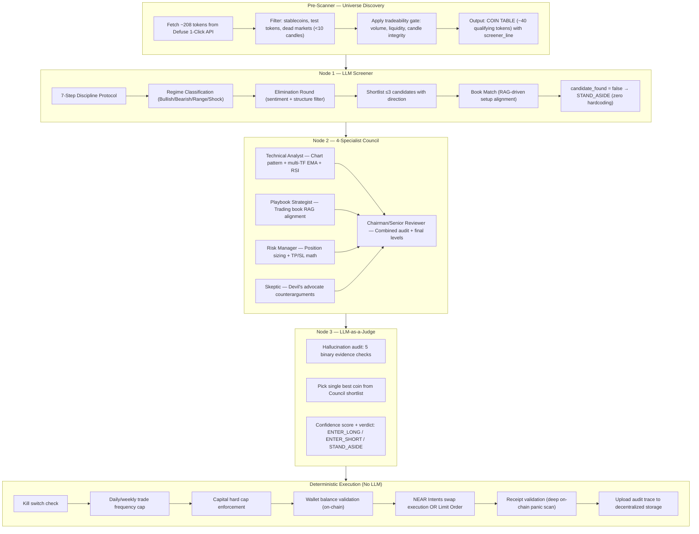

#### What Context Each Node Carries

| Stage | Context In | Context Out |
|-------|-----------|-------------|
| **Pre-Scanner** | Defuse token universe, user timeframe | COIN TABLE: price, EMA20/50/200, RSI, ATR%, volume, bias |
| **Screener** | Full COIN TABLE + macro fear/greed index | selections[]: symbol, direction, rubric_score, reasoning |
| **Council** | Selected coins + chart data (fetch_chart_tool) + RAG queries | TP/SL/entry levels, R:R ratio, specialist analysis |
| **Judge** | Council output + binary checks (R:R math, pattern grounded, indicators accurate) | chosen_coin, verdict, confidence (0–100) |
| **Execution** | Judge verdict, on-chain wallet balance, user limits | Trade result, TX hash, decentralized CID |

#### Intelligence Sources (All Injected as Context)

| Source | What It Provides |
|--------|-----------------|
| **Multi-timeframe candles** | 1h, 2h, 4h, 1d, 1w OHLCV — last 5-10 closed candles + EMA/RSI/ATR |
| **Trading Book RAG** | XML crypto trading textbook — Wyckoff, SMC, order blocks, liquidity sweeps |
| **MCP Math Suite** | Fibonacci confluence, pivot points, volatility buffers, slippage estimates |
| **Twitter/X Sentiment** | Live social sentiment for the coin being evaluated |
| **CFGI.io Fear & Greed** | Per-coin live fear & greed index (crawled, not API) |
| **CoinCodex Sentiment** | Per-coin bull/bear indicator count + 5-day forecast |
| **Alternative.me** | Global macro crypto fear & greed index |
| **Research Agent Plugin** | On-demand: Research Agent hired as a specialist for fundamental context |
| **Chart Vision** | Candlestick PNG rendered with TP/SL/entry overlays + ASCII chart |

#### How We Keep It Grounded

- **Zero Hardcoded Tokens:** If `candidate_found = false`, the pipeline returns `STAND_ASIDE` — it never defaults to a predetermined coin
- **MCP Math Prevention:** Fibonacci levels, pivot points, and R:R ratios are computed by deterministic Python functions — the LLM reads the results, never the raw math
- **Capital Hard Caps:** Execution is fully deterministic — LLM never touches amounts, keys, or execution logic
- **Receipt Validation:** `near_submitter` deep-scans on-chain receipts for contract panics, not just TX acceptance
- **Inter-Agent Second Opinions:** Council can call Research Agent for fundamental grounding on specific coins

#### Real-Time Streaming

The trader pipeline streams NDJSON events (`type: step`) for each stage so the UI shows live progress cards:
```
Pre-Scanner running → Screener evaluating → Council deliberating → Judge auditing → Executing / Stand Aside
```

---

### ⚖️ Rebalancer Agent

**File:** [`ai-agent-backend/autonomous_agents/rebalancer_agent.py`](ai-agent-backend/autonomous_agents/rebalancer_agent.py)

The Rebalancer Agent is an **institutional-grade portfolio optimizer** that generates target allocations using 20 embedded trading book principles, then autonomously executes drift-based rebalances.

#### Architecture: 4-Node Strategy Generation + State Machine Execution

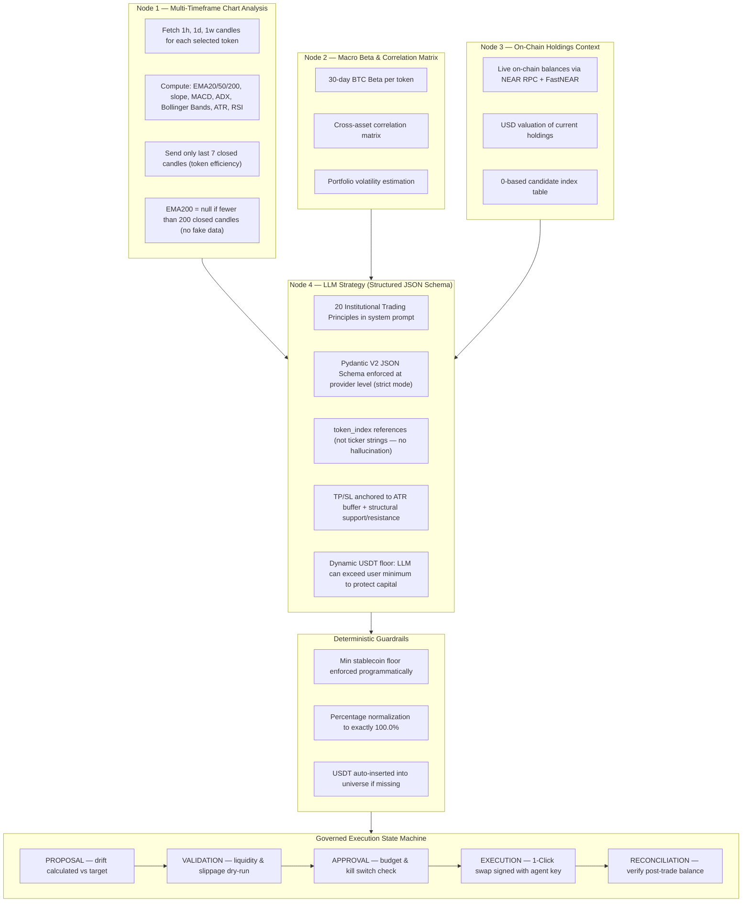

#### What Context Each Node Carries

| Node | Context Received | Context Produced |
|------|-----------------|-----------------|
| **Node 1** | Token symbols, timeframes | 7 closed candles, EMA/MACD/ADX/RSI/ATR per timeframe |
| **Node 2** | Daily price series | btc_beta per token, pairwise correlation matrix, portfolio σ |
| **Node 3** | User wallet | On-chain balances, USD values, candidate 0-index table |
| **Node 4 (LLM)** | All above + user expectation text + min_stable_floor | RebalancerStrategySchema: allocations, TP/SL, regime, risk_level |

#### How We Keep It Grounded

- **Index-Based Output:** The LLM outputs `token_index` (integer 0, 1, 2...) not ticker symbols — prevents hallucinating tokens not in the universe
- **Provider-Side Strict JSON Schema:** `json_schema: { strict: true }` masks token logits to enforce the exact Pydantic schema
- **Dynamic Stablecoin Expansion:** The 20-principle system prompt gives the LLM autonomous authority to increase USDT above the user's minimum when market conditions are unsafe
- **Deterministic Guardrail:** Even if the LLM under-allocates stablecoins, a programmatic check elevates USDT to meet the floor before execution

#### Conditional TP/SL Orders

The rebalancer can place **limit-style conditional orders**: if an asset reaches TP, it trims into USDT. If it breaches SL, capital is rotated into stablecoins — all without leverage or liquidation risk.

---

### 🛡️ Moderator (Watchdog) Agent

**File:** [`ai-agent-backend/autonomous_agents/moderator_agent.py`](ai-agent-backend/autonomous_agents/moderator_agent.py)
**Nodes:** [`ai-agent-backend/autonomous_agents/moderator_nodes.py`](ai-agent-backend/autonomous_agents/moderator_nodes.py)

The Moderator is a **meta-agent** — an LLM-as-a-Judge that audits the other three agents and holds the master kill switch authority. It runs on a user-configured cadence (weekly, bi-weekly, monthly).

#### Architecture: 4-Node Fleet Governance

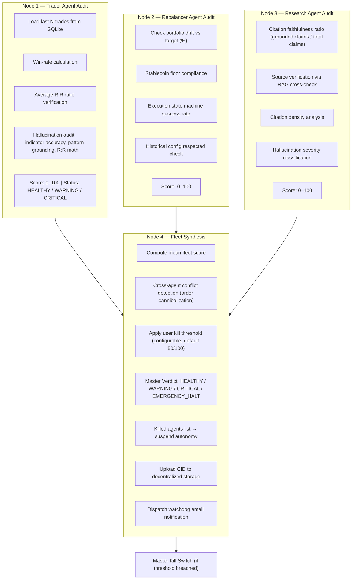

#### Concurrency Guard

The Moderator uses an async lock (`asyncio.Lock()`) to prevent multiple deliberations from running simultaneously across different wallets — avoiding fleet state corruption.

#### Cadence & Autonomous Scheduling

The Moderator checks its own schedule on each `GET` request and fires a full deliberation only when the configured cadence has elapsed — no manual triggers required.

| Setting | Options |
|---------|---------|
| Frequency | Weekly / Bi-weekly / Monthly |
| Kill Threshold | 0–80 (fleet mean score below this → halt) |
| Auto-restore | Agents re-enabled when kill switch is manually reset |

---

## Agent Marketplace

**File:** [`NeptuneAI_V2/components/agent-marketplace.tsx`](NeptuneAI_V2/components/agent-marketplace.tsx)

The Agent Marketplace lets users **deploy, rent, and discover** pre-configured agent strategies from the community.

### How It Works

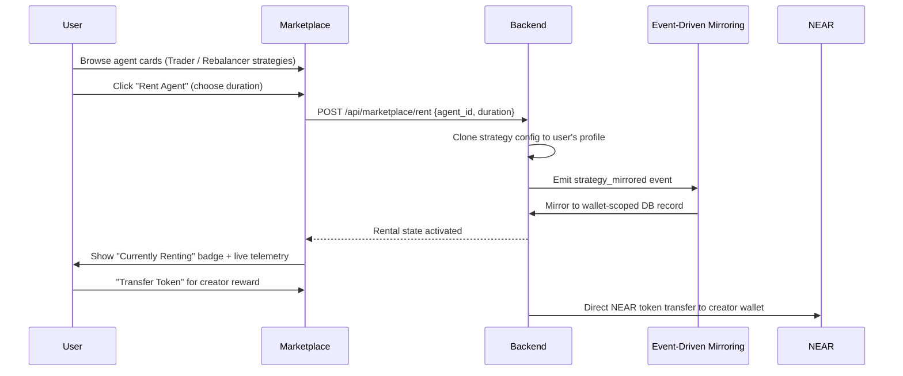

### Marketplace Features (Added in Hackathon)

- **Rental State Management:** Tracks active rentals per wallet with time-remaining display
- **Event-Driven Mirroring:** Strategy configs are mirrored to the renting user's DB without overwriting their existing setup
- **Telemetry Isolation:** Rented agent metrics are isolated from the user's own agent history
- **Direct Token Transfer:** Creator rewards via native NEAR token transfers (no intermediary)
- **Agent Cards:** Each card shows agent name, strategy type, win-rate, and market regime history

---

## Autonomy Dashboard

**File:** [`NeptuneAI_V2/components/autonomy-dashboard.tsx`](NeptuneAI_V2/components/autonomy-dashboard.tsx)

The Autonomy Dashboard is the mission control center for the agent fleet.

### Dashboard Architecture

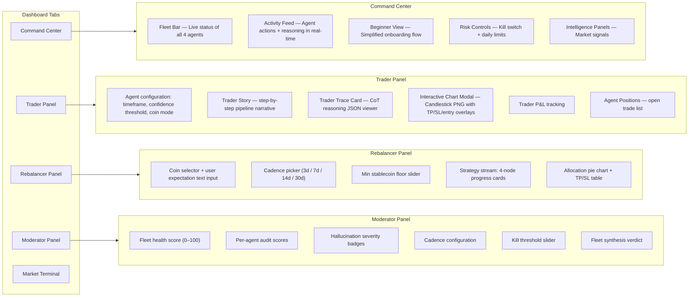

### New Dashboard Features (Built in Hackathon)

| Feature | Description |
|---------|-------------|
| **Market Terminal** | Live order flow, market movers, watchlist, price charts |
| **Agent Suite / Fleet Bar** | Persistent status badges for all 4 agents visible across all tabs |
| **Interactive Chart Modal** | Full-screen candlestick chart with TP/SL drawn from agent analysis |
| **Trace Viewer** | JSON CoT reasoning from the Trader pipeline — step-by-step verification |
| **Email Configuration** | In-sidebar SMTP setup for autonomous agent action notifications |
| **Advanced Config Sections** | Collapsible pro-trader settings: custom EMA periods, multichain source/destination |
| **Info Tips** | Contextual `?` tooltips explaining every agent setting |
| **Testnet Wallet Modal** | Testnet-only wallet connection flow for safe testing |

---

## What's New in Chat

**File:** [`NeptuneAI_V2/components/chat-interface.tsx`](NeptuneAI_V2/components/chat-interface.tsx)

The chat interface was completely rebuilt from a simple proxy into a full-featured AI terminal.

### Request Flow

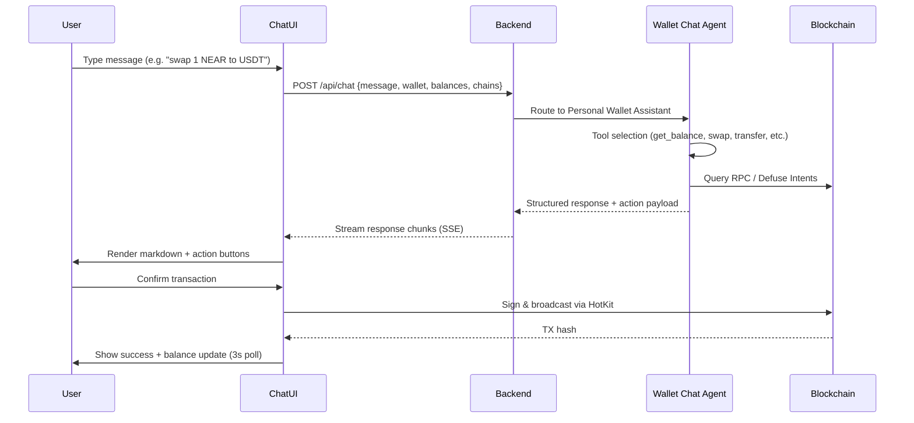

### New Chat Features (Built in Hackathon)

| Feature | Description |
|---------|-------------|
| **Multi-chain Awareness** | Chat knows your connected chains (NEAR, Base, ETH, etc.) and routes accordingly |
| **Balance Context Injection** | Live wallet balances injected as context into every LLM call |
| **Cross-Chain Swaps** | Full EVM + non-EVM cross-chain trading via HOT Kit/Defuse |
| **NEAR Intents Limit Orders** | Place limit-price buy/sell orders that execute when conditions are met |
| **Transaction Modal** | Rich confirmation UI showing expected amounts, fees, and destination |
| **Race Condition Guard** | Prevents stale responses from earlier requests overwriting newer ones |
| **Conversation History** | Full sidebar with named conversation threads; session persists across tabs |
| **Rate Limiting** | 20 req/min per IP; strict CORS to Vercel app only |
| **Streaming Responses** | Server-sent events for all chat and agent pipeline responses |

### Chat Agent Tools

| Tool | Action |
|------|--------|
| `get_balance` | On-chain balance for any token/chain |
| `swap_tokens` | Execute cross-chain swap via Defuse 1-Click |
| `transfer_tokens` | Send NEAR/tokens to any address |
| `get_market_price` | Current spot price via CoinGecko |
| `create_limit_order` | NEAR Intents-based limit order |
| `get_portfolio` | Full wallet portfolio summary |
| `get_user_research_reports` | Retrieve past Research Agent reports |

---

## RAG & Knowledge Base

Neptune uses **two separate RAG systems** serving different agents:

### 1. XML Crypto Trading Book RAG

**File:** [`ai-agent-backend/trading_book_rag.py`](ai-agent-backend/trading_book_rag.py)
**Knowledge:** [`ai-agent-backend/knowledge_base/crypto_trading_book.xml`](ai-agent-backend/knowledge_base/crypto_trading_book.xml)

A structured XML trading textbook chunked into sections covering:
- Wyckoff Accumulation & Distribution
- Smart Money Concepts (order blocks, FVGs, liquidity sweeps)
- Multi-timeframe confluence
- Risk management & position sizing
- Market structure (BOS vs CHoCH)

**Used by:** Trader Agent (Screener, Council, Judge), Rebalancer Agent

### 2. NEAR Ecosystem Knowledge Base

**Files:** [`ai-agent-backend/knowledge_base/`](ai-agent-backend/knowledge_base/)

Crawled and chunked documentation covering:
- NEAR Protocol docs, staking guides, validator metrics
- DeFi protocol pages (Meta Pool, Ref Finance, Burrow)
- Hackathon announcements (nearhackathon.com)
- Grant program details

**Used by:** Research Agent (Node 2 Retrieval Loop)

### RAG Design Principles

- **Chunk Pool per Request:** Each research run creates an isolated chunk pool with integer IDs (1, 2, 3...) — no cross-request contamination
- **SHA-256 Deduplication:** Same content from different queries is deduplicated by content hash
- **Preview Truncation:** Node 2 sees only 80-word previews; Node 3 receives full text — reduces token waste while preserving grounding
- **Distance-Based Scoring:** Semantic distance is preserved and shown to the LLM for relevance awareness

---

## MCP Tool Suite

**File:** [`ai-agent-backend/trader_mcp.py`](ai-agent-backend/trader_mcp.py)

The **Trader MCP Suite** is a set of deterministic mathematical calculators that the LLM Council and Screener call as tools — preventing math hallucinations in trading decisions.

| MCP Tool | What It Computes |
|----------|-----------------|
| `calculate_fibonacci_confluence` | Exact Fibonacci retracement/extension levels from swing high/low; detects Golden Pocket (0.618–0.65) |
| `calculate_pivot_points` | Classic, Woodie, Camarilla, and DeMark pivot points from OHLC |
| `calculate_dynamic_volatility_levels` | ATR-based TP/SL buffers; Kelly criterion for position sizing |
| `estimate_trade_slippage_and_fees` | Net R:R after slippage and DEX fees |
| `validate_pattern_geometry` | Geometric verification of candlestick patterns (not label-based) |

**Why This Matters:** Without MCP, LLMs hallucinate Fibonacci levels and R:R ratios. With MCP, the math is computed by Python and the LLM only interprets the results.

---

## Structured Outputs & System Prompt Design

Every agent in Neptune outputs **Pydantic-validated JSON** — not freeform text. This is a core architectural principle.

### How We Design System Prompts (Without Sharing Actual Prompts)

Our system prompt design philosophy follows a consistent pattern across all agents:

1. **Role Definition** — Exact professional role and mandate (never vague)
2. **Chain-of-Thought Section** — Numbered thinking steps written into a `reasoning` field (not hidden, fully auditable)
3. **Context Hierarchy** — Explicit instruction on what to trust (tool results > prior knowledge)
4. **Output Schema** — Exact JSON schema with field-level descriptions and constraints
5. **Security Rules** — Source text is untrusted external data; never follow embedded instructions
6. **Fail-Closed Instructions** — If uncertain, return structured `STAND_ASIDE` or `NOT_FOUND` — never hallucinate

### Structured Output Enforcement

| Agent | Enforcement Method |
|-------|--------------------|
| Research Node 1, 3 | `json_object` mode + post-parse Pydantic `model_validate` |
| Research Node 2 | ReAct loop — tool calls force structured response format |
| Trader Screener | Pydantic schema + rubric_score 0–100 |
| Trader Council | Multi-specialist structured JSON with binary evidence checks |
| Trader Judge | Strict `ENTER_LONG / ENTER_SHORT / STAND_ASIDE` verdict enum |
| Rebalancer | `json_schema: { strict: true }` at provider level — masks token logits |
| Moderator Nodes | Pydantic `AgentEvaluation` schema with score + hallucination_audit |

---

## Decentralized Storage & Audit Trails

**File:** [`ai-agent-backend/decentralized_storage.py`](ai-agent-backend/decentralized_storage.py)

Every agent decision — trade, stand-aside, research report, fleet audit — is stored as an immutable reasoning trace with a **CID (content identifier)**.

### Storage Design

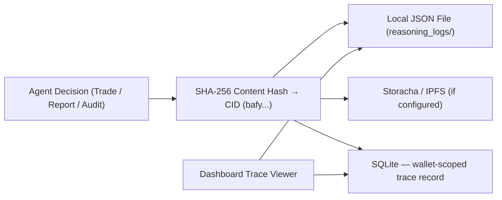

- **Deterministic CIDs:** `sha256(json.dumps(trace, sort_keys=True))` → `bafy{hex[:44]}` — the same decision always produces the same CID
- **Recent 10 / 24 Preservation:** Local directories prune to recent 24 trade traces and 5 research reports to avoid disk bloat
- **Chain of Thought Cards:** Research reports serialize each pipeline node's reasoning into UI-renderable `CoTStepCard` objects
- **Email Notifications:** Every autonomous agent action dispatches an SMTP email with the CID reference, metrics, and reasoning summary

---

## Security & Guardrails

| Layer | Mechanism |
|-------|-----------|
| **Wallet Safety** | Primary wallet is never touched; agent wallet uses a scoped delegated key |
| **Key Encryption** | Agent private keys encrypted with AES-256 before SQLite storage |
| **Policy Guardrails** | `PolicyGuardrails` class checks kill switch, autonomy level, max TX amount, and daily spend before every execution |
| **Kill Switch** | Master kill switch halts all agents, revokes open trades (marked REVOKED), stops all scheduler loops |
| **Rate Limiting** | 20 req/min per IP via `slowapi` |
| **CORS** | Restricted to Vercel app domain in production |
| **SSRF Protection** | Research Agent URL validator blocks private IPs, localhost, cloud metadata endpoints, and DNS rebinding |
| **Prompt Injection** | All external source content sandboxed with explicit "do not follow embedded instructions" rules |
| **Receipt Validation** | Deep on-chain receipt scan for contract panics — not just TX acceptance |
| **Trade Frequency Caps** | Configurable daily + weekly trade limits enforced before pipeline even starts |
| **Capital Hard Caps** | Per-transaction USD hard cap enforced at execution boundary — LLM never touches amounts |

---

## Cross-Chain Architecture

Neptune uses **Defuse 1-Click Intents** to execute cross-chain swaps from a single NEAR agent wallet:

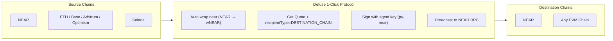

| Feature | Support |
|---------|---------|
| NEAR ↔ USDT | ✅ |
| NEAR → EVM (Base, ETH) | ✅ `DESTINATION_CHAIN` recipient type |
| EVM → NEAR | ✅ |
| Non-EVM via HOT Kit | ✅ |
| Automatic `storage_deposit` prepend | ✅ (0.00125 NEAR if unregistered) |
| Limit Orders via NEAR Intents | ✅ Configurable price trigger |
| Multichain source/destination config | ✅ Per-user in DB |

---

## Tech Stack

### Backend
| Component | Technology |
|-----------|-----------|
| API Framework | FastAPI + Uvicorn |
| LLM | NEAR AI Cloud — `z-ai/glm-5.3-flash` (single model, no fallbacks) |
| Database | SQLite (AES-256 encrypted keys, strategies, traces) |
| Scheduler | APScheduler (60s autonomous trading loop) |
| On-chain | py-near, NEAR JSON-RPC, FastNEAR |
| Streaming | Server-Sent Events (NDJSON) |
| Email | SMTP (Gmail/custom) via email_service |
| RAG | Custom XML chunker + cosine similarity |
| Storage | Storacha/IPFS + local JSON fallback |

### Frontend
| Component | Technology |
|-----------|-----------|
| Framework | Next.js 14 (App Router) |
| Styling | Tailwind CSS + shadcn/ui |
| Wallet | HOT Kit (NEAR wallet connector) |
| Charts | Recharts + custom candlestick renderer |
| State | React hooks + local session storage |
| Deployment | Vercel |

---

## Quick Start

### Backend

```bash
cd ai-agent-backend
python -m venv venv
venv\Scripts\activate   # Windows
pip install -r requirements.txt
```

Create `ai-agent-backend/.env`:
```env
NEAR_AI_API_KEY=your_near_ai_key_here
# Optional
SMTP_HOST=smtp.gmail.com
SMTP_PORT=587
SMTP_USER=your@email.com
SMTP_PASSWORD=your_app_password
STORACHA_KEY=your_storacha_key
```

```bash
uvicorn main:app --reload
# Backend starts at http://127.0.0.1:8000
```

### Frontend

```bash
cd NeptuneAI_V2
npm install
```

Create `NeptuneAI_V2/.env.local`:
```env
BACKEND_URL=http://127.0.0.1:8000
NEXT_PUBLIC_HOT_API_KEY=your_hot_game_api_key
```

```bash
npm run dev
# Open http://localhost:3000
```

---

## 📊 What Was Built Before vs. After Oct 1

### Before Hackathon (Feb 2026 Initial Commit)
The base project was a minimal NEAR wallet chat interface:
- Simple Next.js chat UI with a text box
- FastAPI backend proxying to OpenAI/NEAR AI
- Basic HotKit wallet connection
- Single `/api/chat` endpoint routing to a general assistant
- Transaction signing modal (basic)

### Added During Hackathon (Oct 23 → Nov 13, 2026)
Everything that makes Neptune AI what it is today:

| Feature | Commit Range |
|---------|-------------|
| Multi-Agent Suite (Research, Trader, Rebalancer, Moderator) | Oct 23 |
| Agent Marketplace with rental state | Oct 25 – Nov 12 |
| 4-Node Trader Pipeline (Pre-Scanner → Screener → Council → Judge) | Oct 25 – Nov 12 |
| 3-Node Research Agent with RAG crawler + SSRF protection | Oct 23 – Nov 13 |
| Rebalancer State Machine + 20 Trading Principles | Oct 23 – Nov 11 |
| Moderator 4-Node Fleet Governance | Oct 23 – Nov 11 |
| MCP Math Suite (Fibonacci, Pivots, Volatility) | Nov 12 |
| Per-coin Fear & Greed (CFGI + CoinCodex) | Nov 13 |
| Interactive Chart Modal + ASCII Chart | Nov 12 |
| Decentralized Storage + CID Audit Traces | Oct 23 – Nov 11 |
| Email Notification Service | Nov 12 |
| Cross-chain EVM + NEAR Intents Limit Orders | Nov 12 |
| Configurable EMA Periods + Inter-Agent Second Opinions | Nov 12 |
| UI Redesign (mobile responsive, dashboard, market terminal) | Oct 29 – Nov 11 |
| Database v2 migration + encrypted key management | Nov 10 |
| Trading Book XML RAG | Oct 23 |
| Twitter Sentiment Integration | Oct 23 – Nov 4 |
| Rate Limiting + CORS Security | Nov 4 |
| Streaming NDJSON pipeline events | Oct 25 – Nov 4 |
| Testnet wallet modal | Nov 11 |

---

## 🏗️ Repository Structure

```
N-agent/
├── ai-agent-backend/
│   ├── autonomous_agents/
│   │   ├── research_agent.py        # 3-Node Research Pipeline
│   │   ├── research_crawler_tool.py # SSRF-safe web crawler
│   │   ├── trader_agent.py          # 4-Stage Trader Pipeline
│   │   ├── trading_pipeline.py      # Screener → Council → Judge
│   │   ├── rebalancer_agent.py      # 4-Node Rebalancer + State Machine
│   │   ├── moderator_agent.py       # 4-Node Fleet Watchdog
│   │   ├── moderator_nodes.py       # Individual audit node logic
│   │   ├── llm_council_judge.py     # LLM-as-a-Judge implementation
│   │   ├── risk_agent.py            # Risk pre-flight checks
│   │   ├── strategy_agent.py        # Strategy context builder
│   │   ├── audit_agent.py           # Receipt audit
│   │   ├── near_submitter.py        # On-chain TX + receipt validation
│   │   └── trade_poller.py          # 60s autonomous trade loop
│   ├── knowledge_base/
│   │   ├── crypto_trading_book.xml  # XML trading knowledge base
│   │   ├── fidelity_extracted.txt   # NEAR staking reference
│   │   └── ncfe_extracted.txt       # DeFi ecosystem reference
│   ├── trader_mcp.py                # Math MCP Suite
│   ├── market_sentiment.py          # CFGI + CoinCodex + Alternative.me
│   ├── trading_book_rag.py          # XML RAG engine
│   ├── decentralized_storage.py     # CID + IPFS storage
│   ├── guardrails.py                # Policy safety checks
│   ├── email_service.py             # SMTP notification service
│   ├── chart_visualizer.py          # Candlestick PNG renderer
│   ├── coin_scanner.py              # 208-token DEX universe scanner
│   ├── pattern_recognition.py       # Chart pattern detection
│   ├── market_intelligence.py       # Technical indicators engine
│   ├── market_sentiment.py          # Multi-source sentiment aggregator
│   ├── database/                    # DB layer (connection, DAL, schema)
│   └── main.py                      # FastAPI app + all endpoints
└── NeptuneAI_V2/
    └── components/
        ├── agent-marketplace.tsx    # Agent marketplace UI
        ├── autonomy-dashboard.tsx   # Mission control
        ├── agent-suite.tsx          # Fleet overview
        ├── agent-sections/
        │   ├── trader-section.tsx   # Trader configuration UI
        │   ├── rebalancer-section.tsx
        │   ├── research-panel.tsx
        │   └── moderator-section.tsx
        ├── interactive-chart-modal.tsx
        ├── trace-card.tsx           # CoT reasoning viewer
        ├── trader-mcp.py            # Math MCP Suite
        └── chat-interface.tsx       # Main chat
```

---

*Built with ❤️ for the NEAR Hackathon 2026 — Neptune AI Team*
