# Neptune AI

Neptune AI is a fleet of autonomous AI agents for crypto, built on NEAR. A trader, a rebalancer, a researcher and a watchdog work on a budget wallet that you fund and control, while your main wallet stays untouched. You can run the agents yourself, talk to them in chat, or buy a proven agent setup from other users in the Agent Marketplace.

Built for the NEAR Hackathon (October 2026). All code from commit [`9bdf0b1`](https://github.com/TheDarrk/N-agent/commit/9bdf0b1) onward was written after the hackathon announcement. The base project provided only a minimal NEAR wallet chat interface. The agent suite, marketplace, dashboard, research crawler, trading pipeline, governance layer and database layer were built during the hackathon window.

Live demo: [neptuneai-agent.vercel.app](https://neptuneai-agent.vercel.app)

---

## Table of Contents

1. [What We Built](#what-we-built)
2. [System Overview](#system-overview)
3. [Full Application Architecture](#full-application-architecture)
4. [The Delegate Signer Model](#the-delegate-signer-model)
5. [Agent Marketplace](#agent-marketplace)
6. [The Agent Suite](#the-agent-suite)
   - [Research Agent](#research-agent)
   - [Trader Agent](#trader-agent)
   - [Rebalancer Agent](#rebalancer-agent)
   - [Moderator (Watchdog) Agent](#moderator-watchdog-agent)
7. [How the Agents Hire Each Other](#how-the-agents-hire-each-other)
8. [Scheduling and Run Lifecycle](#scheduling-and-run-lifecycle)
9. [Chat Assistant](#chat-assistant)
10. [Dashboard and Market Terminal](#dashboard-and-market-terminal)
11. [Data Layer](#data-layer)
12. [Security Model](#security-model)
13. [Cross-Chain Execution](#cross-chain-execution)
14. [Tech Stack](#tech-stack)
15. [Quick Start](#quick-start)
16. [Testing](#testing)
17. [Future Scope](#future-scope)
18. [Repository Structure](#repository-structure)

---

## What We Built

1. **Agent Marketplace.** The first AI agent marketplace on NEAR. A user who has tuned a Trader, Rebalancer or Research agent can list its configuration for a flat USDT price. A buyer pays the seller directly on-chain, the backend verifies the transfer, and the configuration is applied to the buyer's own agent. Sellers can show live analytics from their real history, and no keys, wallets or emails are ever shared.
2. **Research Agent.** Crawls the sources you give it plus a curated source list, indexes the pages, retrieves evidence in a bounded loop and writes a cited report with signals and opportunity cards.
3. **Trader Agent.** Scans the NEAR Intents token universe, shortlists candidates, builds trade plans, audits them with a judge, and executes through deterministic code under hard limits. It can also place bracket orders on Hyperliquid.
4. **Rebalancer Agent.** Builds a target allocation from chart, correlation and holdings data, then moves the portfolio back to target when drift passes a threshold.
5. **Moderator (Watchdog) Agent.** Audits the other three agents on a schedule, scores them, can switch an underperforming agent off, and answers questions about fleet health.
6. **Delegate signer wallets.** Agents trade from a separate agent wallet. Your primary wallet is never used for autonomous trades.
7. **Chat assistant.** Natural language swaps, transfers, balances, and control of every agent, on NEAR, many EVM chains and Flow.
8. **Autonomy dashboard and market terminal.** Beginner and trader views, live agent state, kill switch, run history, reasoning traces, order flow and charts.
9. **Persistent, wallet-isolated data layer.** Turso libSQL in production, SQLite locally, with per-wallet field encryption and a run-hold mechanism that pauses instead of failing when the database is busy.
10. **Email notifications** for agent actions, stand-asides and reports.

---

## System Overview

Neptune is a decoupled full-stack application. The Next.js frontend talks to a FastAPI backend. The backend runs the agents, owns the database, and talks to NEAR, NEAR Intents (Defuse 1-Click), Hyperliquid, market data providers and the LLM.

| Layer | Responsibility |
|-------|---------------|
| Frontend | Chat, dashboard, agent suite, marketplace, wallet connection, signing user-approved transactions |
| Backend API | Agent endpoints, run streaming (NDJSON), marketplace, wallet management, settings |
| Agents | Research, Trader, Rebalancer, Moderator. LLM nodes for judgment, deterministic code for execution |
| Schedulers | A 30 second poller for due agent runs and a 300 second poller for housekeeping |
| Data layer | Turso libSQL or SQLite, field-level encryption, one namespace per wallet |
| External | NEAR RPC, Defuse 1-Click, Hyperliquid, Binance and Coinbase market data, CFGI, CoinCodex, Alternative.me, X (Twitter), NEAR AI Cloud (LLM), SMTP |

The language model is `z-ai/glm-5.3-flash` served by NEAR AI Cloud through an OpenAI-compatible endpoint. There are no model fallbacks.

---

## Full Application Architecture

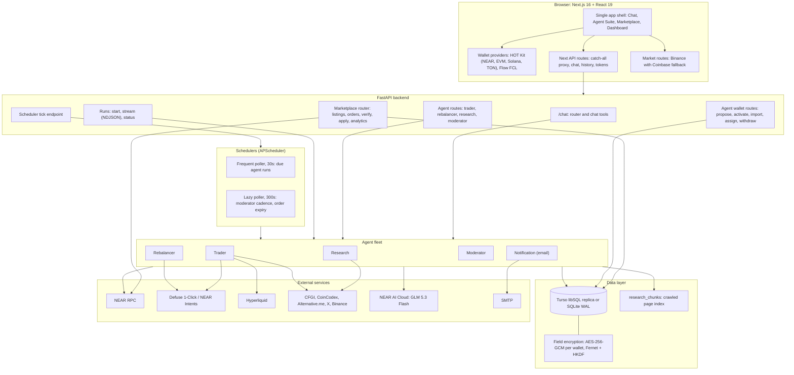

### How a request flows

1. The user connects a wallet. The wallet type (HOT Kit or Flow) decides which chat agent handles the message.
2. Chat messages go through `/chat`. Each turn is injected with a live snapshot of the user's fleet state, so answers about agents come from real data.
3. Agent runs start through `/api/<agent>/start` or `/api/<agent>/stream`. The stream sends step events as NDJSON so the UI shows live progress.
4. Scheduled runs are rows in `scheduled_jobs`. The 30 second poller picks up due rows and runs them under a concurrency limit.
5. Every decision is stored as a record in the wallet's namespace (trace, report or evaluation) with a short readable ID such as `TRC-...`, `RSH-...` or `MOD-...`.

---

## The Delegate Signer Model

Neptune does not use your primary wallet for autonomous trades. You fund a separate agent wallet with a budget, and the agents sign with a key held for that wallet only.

1. The backend generates a keypair for the agent wallet. NEAR keys are ed25519 derived from a 12-word BIP-39 phrase. EVM keys are secp256k1. Flow keys are P-256.
2. For a NEAR implicit account, you fund the account with a transfer signed by your own wallet. For a named subaccount (`<prefix>.<your account>`), your wallet signs a single CreateAccount, Transfer and AddKey transaction.
3. The key added to the agent account is a **full access key**. The `scope` column in the database says `function_call`, but that is a label only. The on-chain permission is `FullAccess`, and the UI says so.
4. The private key and seed phrase are encrypted before they are stored in `core_agent_wallets`.
5. At signing time the backend decrypts the key in memory, signs through `py-near`, broadcasts, and validates the receipt.
6. You can hold up to four agent wallets, assign one wallet per agent, import an existing wallet, withdraw funds, and export the private key of your own agent wallet.

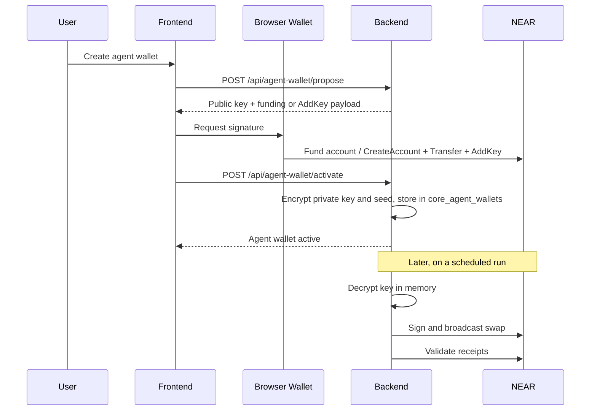

Encryption details:

- `database/encryption.py` derives an AES-256-GCM key per wallet and per field from the master key, the wallet address and a field salt, with a random 12 byte nonce.
- `database/crypto.py` is a second layer using Fernet with HKDF-SHA256, used for marketplace configs and other field-level data.
- Hyperliquid API keys are encrypted with their own field salt.

The planned replacement for stored keys is described in [Future Scope](#future-scope).

---

## Agent Marketplace

**Files:** [`marketplace_router.py`](ai-agent-backend/marketplace_router.py), [`marketplace_service.py`](ai-agent-backend/marketplace_service.py), [`marketplace_verify.py`](ai-agent-backend/marketplace_verify.py), [`agent-marketplace.tsx`](NeptuneAI_V2/components/agent-marketplace.tsx), [`share-agent-modal.tsx`](NeptuneAI_V2/components/share-agent-modal.tsx), [`listing-analytics-modal.tsx`](NeptuneAI_V2/components/listing-analytics-modal.tsx)

The marketplace is a one-time purchase of an agent configuration. It is not a rental, a subscription or copy-trading. After purchase the buyer owns the setup and runs it with their own agent and their own wallet.

### What can be listed

Trader, Rebalancer and Research agents. The Moderator is reserved for the platform and cannot be listed.

### The seller side

- Title of 3 to 100 characters and a flat USDT price.
- One active listing per agent type per seller.
- A payout wallet, which defaults to the seller's wallet and must be a valid NEAR account.
- The listing stores an allow-listed snapshot of the configuration only:
  - Trader: indicator settings, timeframe, confidence threshold, coins, risk and reward settings, pro settings.
  - Rebalancer: allocations, cadence, stablecoin floor, coins.
  - Research: topic, expectations, links, date range.
- Wallets, keys, emails and run history are stripped. The snapshot is encrypted with the seller's wallet key and is never returned by the API.
- After a listing is created or edited, price and description are locked for 24 hours (`MARKETPLACE_EDIT_LOCK_HOURS`). Delete is always allowed.
- Live analytics are computed from the seller's real history: trades taken, open trades, win rate and the last decisions for a trader, recent strategies for a rebalancer, recent reports for research. Nothing is fabricated.

### The buyer side

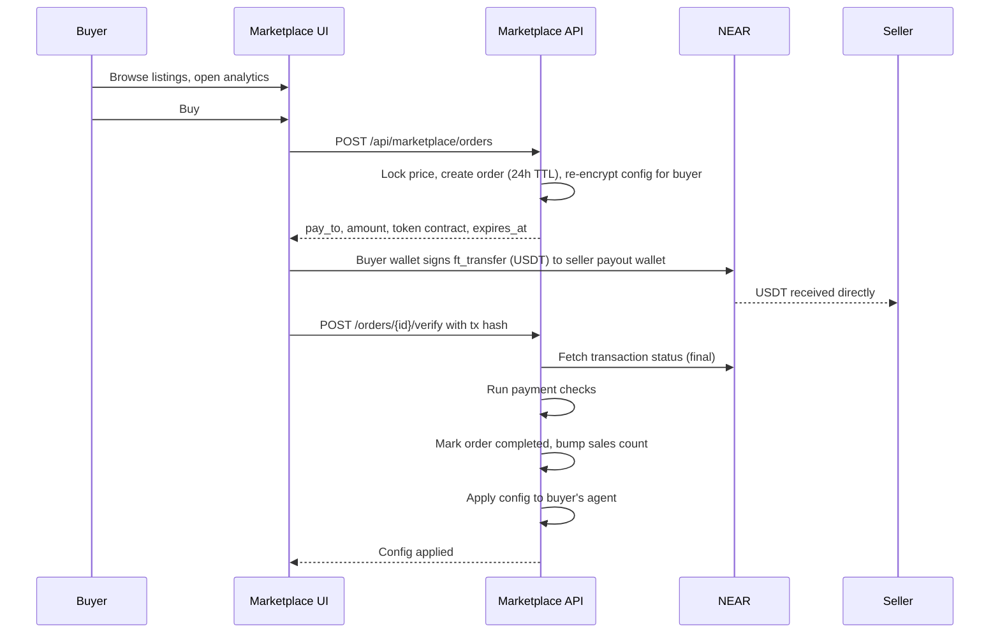

### Payment verification

The backend never trusts the client's claim of payment. For a given transaction hash it checks, in order:

1. The hash is well-formed and has not been used for another order (replay protection).
2. The transaction reaches final status on NEAR RPC, trying fallback endpoints. If the transaction cannot be found yet, the result is `pending_retry`.
3. Neither the transaction nor its receipts contain a failure.
4. The signer is the buyer and the receiver is the USDT contract (`usdt.tether-token.near` on mainnet, `usdt.fakes.testnet` on testnet).
5. The action is an `ft_transfer` or `ft_transfer_call`, the recipient is the seller's payout wallet, and the amount is at least the locked price.
6. The transaction falls inside the order window.

Failures return a reason code: `WRONG_TOKEN`, `WRONG_RECIPIENT`, `AMOUNT_TOO_LOW`, `WRONG_SIGNER`, `OUTSIDE_WINDOW`, `TX_FAILED`, `ALREADY_USED` or `INVALID_HASH`.

### Applying a purchase

- Trader: the tuned parameters are written to the buyer's settings and the trader is activated. The daily trade cap is the lower of the seller's value and the buyer's current value.
- Research: saved as the buyer's research configuration.
- Rebalancer: saved as the buyer's strategy and configuration.
- A run entry named "Marketplace Config Applied" is logged. If applying fails, `POST /orders/{id}/apply` retries it.
- Pending orders that pass their expiry are marked `expired` by the 300 second poller.

There is no escrow and no platform fee. The buyer's transfer goes directly to the seller.

---

## The Agent Suite

Four agents, each with its own nodes and its own data. The pattern is the same everywhere: LLM nodes do the judgment, deterministic code does anything that touches money, and every decision is stored with its reasoning.

---

### Research Agent

**Files:** [`research_agent.py`](ai-agent-backend/autonomous_agents/research_agent.py), [`research_crawler_tool.py`](ai-agent-backend/autonomous_agents/research_crawler_tool.py), [`scrapper/scrapper.py`](ai-agent-backend/scrapper/scrapper.py), [`default_sources.json`](ai-agent-backend/autonomous_agents/default_sources.json)

The Research Agent produces citation-grounded reports on any crypto topic. It is a deterministic crawl step followed by three LLM nodes.

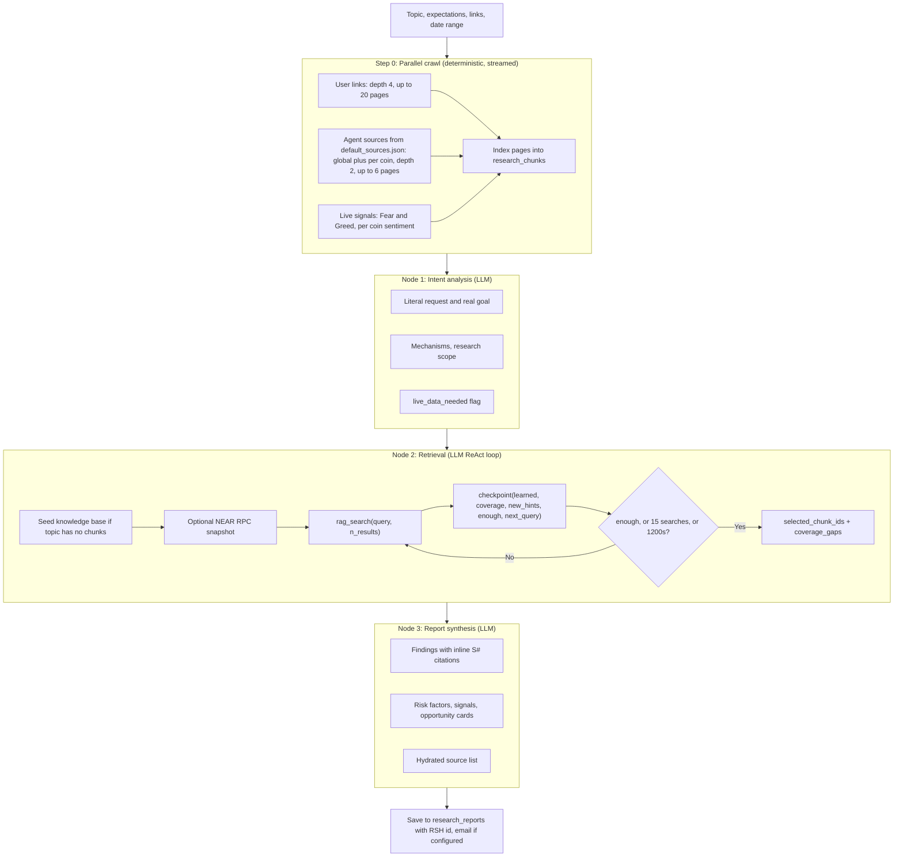

#### How the crawler works

- One thread per seed URL (up to 10 seeds), and inside each seed six pages are fetched in parallel. The whole crawl has a time budget (`RESEARCH_CRAWL_BUDGET_SECONDS`, default 90).
- The crawler stays on the seed's domain, honours `robots.txt`, waits 0.3 seconds between requests and extracts dates so that a date range cutoff can be applied.
- Pages are split into 300 word chunks with 50 words of overlap and stored in the `research_chunks` table in the app database. Duplicate content is skipped by content hash.
- Progress is streamed to the UI as `pre_crawl` events (started, progress, done), so users see pages being read in real time.
- There are no embeddings and no separate vector database. Retrieval is keyword ranking (TF-IDF style) over the SQL table. Each topic is capped at 4000 chunks, and the oldest are pruned.

#### How the nodes behave

| Node | Type | Input | Output |
|------|------|-------|--------|
| Crawl | Deterministic | Links, date range, agent sources | Indexed chunks, live signal chunks |
| 1. Intent | LLM, JSON | Topic, expectations, date range | Intent summary, mechanisms, scope, `live_data_needed` |
| 2. Retrieval | LLM, one search then one checkpoint per turn | Intent, chunk store, optional RPC snapshot | Selected chunk IDs, coverage gaps |
| 3. Synthesis | LLM, JSON | Full text of selected chunks | Report with citations, signals, opportunity cards |

Node 2 runs a strict loop. Each turn is one `rag_search`, followed by one `checkpoint` in which the agent records what it learned, which mechanisms are covered, and whether it has enough. The budget is 15 searches, a 1200 second wall clock and a per-call timeout. If the LLM is unavailable, a keyword fallback selects chunks.

#### Grounding and safety

- **SSRF protection** in two layers: an allowlist of seed and known domains with DNS resolution and private-IP rejection, plus a fetch-level block on localhost, metadata IPs and internal hostnames, with a DNS rebinding check and a redirect limit of 3.
- **Citation cleanup** removes `[S#]` tags that point outside the source list.
- **Prompt injection defence**: source text is wrapped and the model is told never to follow instructions found inside it.
- **Coverage tracking** marks each mechanism as covered, partial or missing so the loop stops querying exhausted topics.
- **Circuit breaker** for an invalid API key, with a keyword fallback.

#### Output

`ResearchReport` carries the title, findings with `[S#]` citations, risk factors, signals (direction is one of BUY, STAKE, ACCUMULATE, PARTICIPATE, WATCH, AVOID, OTHER, with confidence and timeframe), a primary signal, ecosystem opportunity cards, cited sources, coverage gaps, the number of tool calls used, and chain of thought step cards for the UI.

#### Where it is used

- Directly from the dashboard (`/api/research/start`, `/stream`, `/generate`, `/deep-dive`).
- From chat (`request_research_report_tool`).
- By other agents as a second opinion (`/api/research/hire`). See [How the Agents Hire Each Other](#how-the-agents-hire-each-other).
- As a marketplace listing.
- Reports are listed through `/api/research/reports`.

---

### Trader Agent

**Files:** [`trader_agent.py`](ai-agent-backend/autonomous_agents/trader_agent.py), [`trading_pipeline.py`](ai-agent-backend/autonomous_agents/trading_pipeline.py), [`coin_scanner.py`](ai-agent-backend/coin_scanner.py), [`hyperliquid_adapter.py`](ai-agent-backend/autonomous_agents/hyperliquid_adapter.py), [`trader_mcp.py`](ai-agent-backend/trader_mcp.py)

The Trader scans a large token universe, finds a setup, plans the trade, has the plan audited and executes it. LLMs never touch amounts, keys or execution.

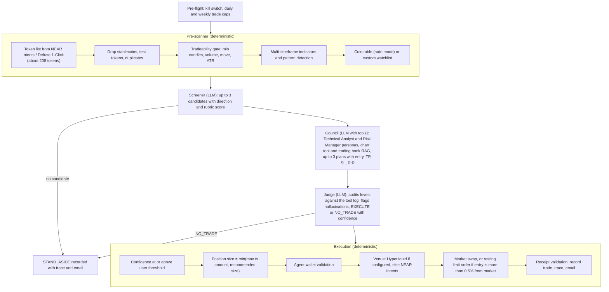

#### Stage by stage

| Stage | Type | Notes |
|-------|------|-------|
| Pre-flight | Deterministic | Kill switch blocks the run. Daily and weekly caps stop scheduled runs. A manual scan over the cap is forced into a dry run. |
| Pre-scanner | Deterministic | Builds the candidate table from the Defuse token list. Thresholds are env configurable (`PRESCAN_MIN_*`). |
| Screener | LLM, no tools | Must meet the user's minimum confidence (default 75). Shorting a coin you do not hold is only allowed when Hyperliquid is configured. |
| Council | LLM with tools | One call plays two personas, Technical Analyst and Risk Manager, using a chart tool and the trading book RAG. The pipeline recomputes R:R. |
| Judge | LLM, no tools | The only stage that can return NO_TRADE. Checks entry, TP and SL against the raw tool log. |
| Execution | Deterministic | No LLM. See below. |

Before committing to a coin, the Trader can hire the Research Agent for a second opinion. See [How the Agents Hire Each Other](#how-the-agents-hire-each-other).

#### Execution venues

- **Hyperliquid** (when configured for the user): an atomic bracket order with entry, take profit and stop loss. Leverage is forced to 1x isolated. Shorts are possible here. The minimum order is $10 and the default network is testnet. The agent can fund Hyperliquid margin from the NEAR agent wallet through 1-Click.
- **NEAR Intents spot** (default): a long buys the coin with the funding token. A short means selling a coin already held into USDT. The agent will not add to an existing long and keeps a NEAR gas reserve.
- If Hyperliquid fails, the trader falls back to NEAR Intents. A trade is only recorded as open if it was actually broadcast. A failed quote or broadcast is recorded as a dropped trade, never as a fake fill.
- Entries more than 0.5% from market become resting limit orders through NEAR Intents (minimum notional $0.10).

#### Intelligence sources

| Source | What it provides |
|--------|-----------------|
| Multi-timeframe candles | 1h, 2h, 4h, 1d, 1w with EMA, RSI, ATR |
| Trading book RAG | XML crypto trading textbook: Wyckoff, smart money concepts, order blocks, liquidity sweeps |
| Math calculators (`trader_mcp.py`) | Fibonacci confluence, pivot points, volatility based TP and SL buffers, slippage and fee estimates, pattern geometry checks. Plain Python functions, not an MCP server |
| X (Twitter) sentiment | Live social sentiment per coin |
| CFGI.io | Per coin Fear and Greed |
| CoinCodex | Per coin bull and bear indicator count |
| Alternative.me | Global Fear and Greed |
| Chart rendering | ASCII chart and PNG candlestick with TP, SL and entry overlays |
| Hyperliquid funding | Funding data for perps |

#### Guardrails

- Zero hardcoded tokens: no candidate means STAND_ASIDE.
- All math comes from deterministic Python. The LLM reads results and never computes them.
- Hard per-transaction cap, daily and weekly trade caps, and a master kill switch.
- Receipt validation scans on-chain receipts for contract panics, not only for transaction acceptance.
- Every outcome, including stand-asides, dropped trades and errors, gets a stored trace (`TRC-` id, including the chart image). Stand-asides also send a scan report email.
- Progress is streamed as typed step events so the UI shows each stage live.

---

### Rebalancer Agent

**File:** [`rebalancer_agent.py`](ai-agent-backend/autonomous_agents/rebalancer_agent.py)

The Rebalancer is a spot, long-only portfolio manager that runs on NEAR. It builds a target allocation, then keeps the portfolio near that target. It has no take profit or stop loss orders. Those belong to the Trader.

#### Strategy generation (four nodes)

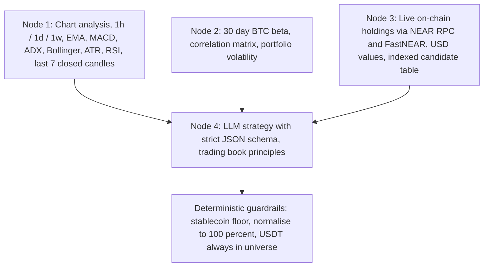

- The LLM returns `decision` (NEW, PERSIST or REVISE), target allocations by token index (not ticker strings, which prevents invented tokens), and a rebalance cadence of 3, 7, 14 or 30 days.
- A programmatic minimum stablecoin floor (default 10 percent) is enforced after the LLM answers.
- The candidate universe comes from the Defuse token list.

#### Execution state machine

Runs on the schedule you set (cadence in days, default 7). Each run measures drift against the target (default threshold 5 percent).

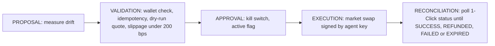

- A run swaps one overweight asset into one underweight asset.
- State is stored in `rebalancer_executions`.
- A 5 minute idempotency key prevents duplicate swaps.
- The rebalancer asks the Research Agent for a second opinion on the underweight asset.
- Chain support is NEAR only. Bridged assets are held in a NEAR agent wallet.

---

### Moderator (Watchdog) Agent

**Files:** [`moderator_agent.py`](ai-agent-backend/autonomous_agents/moderator_agent.py), [`moderator_nodes.py`](ai-agent-backend/autonomous_agents/moderator_nodes.py), [`moderator_ask.py`](ai-agent-backend/moderator_ask.py), [`notification_agent.py`](ai-agent-backend/notification_agent.py)

The Moderator audits the other three agents and holds kill authority. It runs on a cadence you choose: weekly, bi-weekly or monthly.

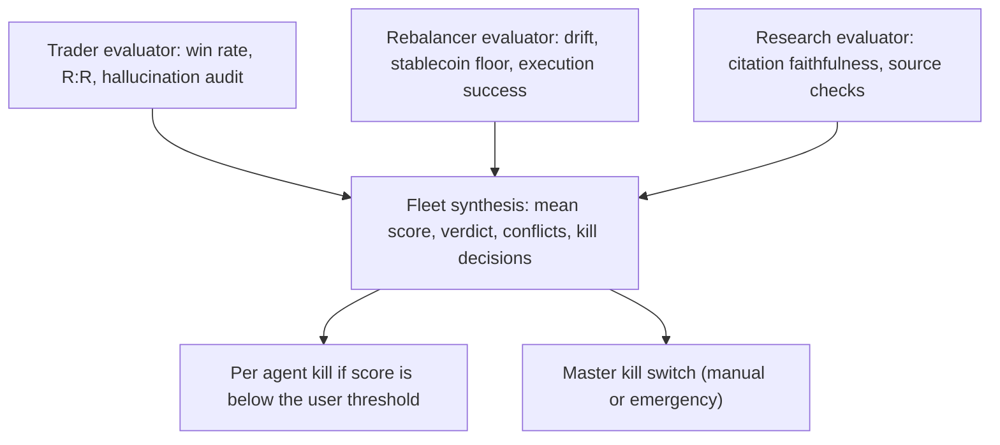

- Three evaluator nodes and one synthesis node. Each evaluator combines LLM-as-judge with deterministic metrics.
- Each agent gets a score from 0 to 100. The fleet score is the mean. Verdicts range from OPTIMAL_HEALTH (80 and above) through MODERATE_RISK and ELEVATED_DRIFT to SAFETY_BREACH_SUSPEND.
- If an agent scores below the user's kill threshold (0 to 80, default 50), that agent is switched off. For the trader, open trades are marked REVOKED.
- The master kill switch (dashboard, chat, or `/api/kill-switch`) deactivates every agent and strategy and sets autonomy to zero. Resetting it re-enables the fleet. Emergency kill also revokes open trades.
- A lock prevents two deliberations from running at once.
- Evaluations are stored with a `MOD-` id.

#### Ask the Moderator

`POST /api/moderator/ask` answers questions about the fleet in 13 areas (overview, profit, risk, change, trader, drift, rebalancer, research, market, wallets, marketplace, activity, history). The answer is built only from real data for the selected sections, with a deterministic data-only fallback if the LLM fails. The response contains an answer, highlights and next steps.

#### Fleet metrics

`agent_metrics.py` computes every number shown in the dashboard and in marketplace analytics from the database: trader decisions from traces, rebalancer strategies and executions, research reports and moderator health scores. It also builds the live snapshot injected into each chat turn.

---

## How the Agents Hire Each Other

Agents can ask the Research Agent for a second opinion on a coin. This is free inside the platform.

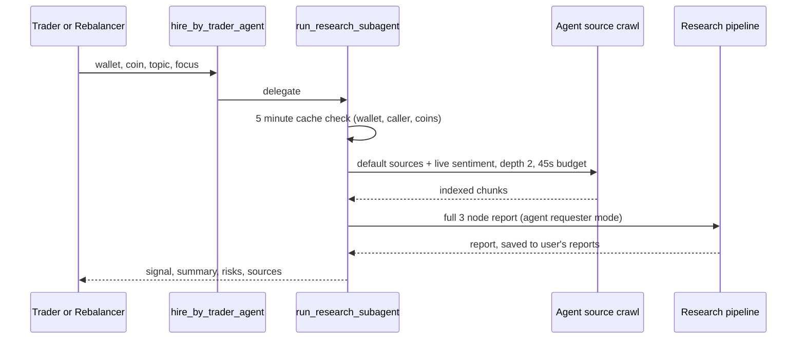

Where it is wired in:

- **Trader:** when the researcher option is on in the trader settings, the Trader hires the Research Agent after it selects a coin, in parallel with sentiment and chart collection. The Research Agent's signal, summary, risks and sources go to the council as "Researcher Intel" and are stored in the trade trace. The wait is time-bounded, so a trade is never held up for long.
- **Chat:** the Trader can also request a second opinion on demand through `trader_hire_research_tool`.
- **Rebalancer:** hires the researcher during validation for the underweight asset.
- **API:** `POST /api/research/hire`.

---

## Scheduling and Run Lifecycle

- **Frequent poller (30 seconds, `FREQUENT_POLL_SECONDS`):** runs due rows from `scheduled_jobs` under a concurrency limit (`JOB_MAX_CONCURRENCY`, default 2).
- **Lazy poller (300 seconds, `LAZY_POLL_SECONDS`):** moderator cadence checks, expiry of stale marketplace orders and housekeeping.
- Pollers run on Render by default, or locally with `RUN_SCHEDULER=1`. `/api/scheduler/tick` accepts GET, POST and HEAD so an external pinger can keep a free instance awake.
- Default job intervals: trader every 3600 seconds, rebalancer every cadence in days (7 by default). Missing jobs for active agents are recreated automatically, and stale runs are marked failed on boot.
- **Run hold:** if the database is busy, the run is put ON HOLD. The writer waits and retries, the stream emits `on_hold` events, and the run resumes. A busy database does not fail a run.
- Runs have start, stream and status endpoints, and the UI reconnects to a run in progress.

---

## Chat Assistant

**Files:** [`agents.py`](ai-agent-backend/agents.py), [`orchestrator.py`](ai-agent-backend/orchestrator.py), [`agent_tools.py`](ai-agent-backend/agent_tools.py), [`market_agent_tools.py`](ai-agent-backend/market_agent_tools.py), [`flow_agent_tools.py`](ai-agent-backend/flow_agent_tools.py), [`glm_transport.py`](ai-agent-backend/glm_transport.py), [`chat-interface.tsx`](NeptuneAI_V2/components/chat-interface.tsx)

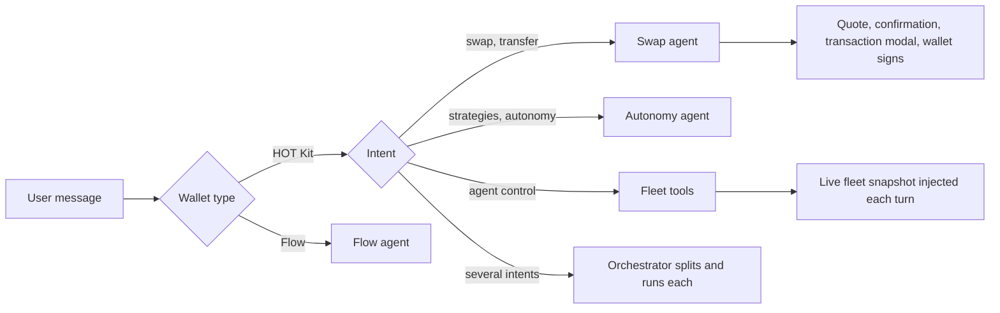

| Tool group | Tools |
|------------|-------|
| Swaps and transfers | Available tokens, token chains, name validation, swap quote, confirm swap, transfer, confirm transfer |
| Fleet control | `agent_suite_mcp_tool` with get_status, get_history, set_active, configure, trigger_run for trader, rebalancer, researcher, moderator and fleet |
| Trader | Status, run a scan |
| Rebalancer | Status |
| Research | Request a report, hire for a second opinion |
| Moderator | Watchdog status, kill switch |
| Strategies | Create, list, remove, update autonomy settings, autonomy status |
| Flow | List NFTs, transfer NFT |

Notes:

- Swaps go through Defuse 1-Click. The tool layer maps many EVM chains and non-EVM chains (Solana, TON, Tron, Stellar, Cosmos, Bitcoin, Dogecoin, XRP, Cardano, Aptos, Sui, Litecoin, Zcash).
- Every user turn is saved to `chat_messages`. History is grouped into conversations, and a gap of 30 minutes or more starts a new conversation.
- Rate limit of 20 requests per minute per IP on `/chat`.
- Flow wallets can list and transfer NFTs, signed through FCL.

---

## Dashboard and Market Terminal

All pages (`/`, `/chat`, `/dashboard`, `/agent-suite`, `/marketplace`) render one app shell (`client-app.tsx`), which switches between chat, agent suite, marketplace and dashboard.

| Area | What it does |
|------|--------------|
| Beginner view | Plain language summary of the fleet, kept in the `?mode=` query parameter |
| Trader view | Detailed controls and state |
| Command center | Agent switches, review button, kill switch, activity feed |
| Risk controls | Limits and kill threshold |
| Agent sections | Trader (config, story, trace card, P&L, interactive chart modal), Rebalancer (coins, cadence, floor, strategy stream, allocations), Research (topic, links, live crawl stream, report view), Moderator (health, audits, cadence, threshold) |
| Marketplace | Browse, analytics modal, buy, publish and manage listings |
| Market terminal | Price chart, order book, live trades, depth chart, watchlist, movers, agent positions. Display only, no order entry |
| Wallet manager | Create, import, assign, fund, withdraw and export agent wallets |
| Hyperliquid settings | Store an encrypted Hyperliquid key and choose network |
| Email settings | SMTP notifications for agent actions |
| Testnet wallet modal | Safe testing flow |
| Info tips | Contextual help on every setting |

Market data routes (`candles`, `tickers`, `flow`) call Binance directly with a Coinbase fallback.

---

## Data Layer

**Files:** [`database/connection.py`](ai-agent-backend/database/connection.py), [`database/dal.py`](ai-agent-backend/database/dal.py), [`database/schema.sql`](ai-agent-backend/database/schema.sql), [`docs/DATABASE_ARCHITECTURE.md`](ai-agent-backend/docs/DATABASE_ARCHITECTURE.md)

- **Production:** Turso libSQL as an embedded replica with cloud sync, so data survives a free tier host restarting. A background thread pulls changes, and writes are debounced.
- **Local:** SQLite in WAL mode.
- **Wait behaviour:** one process-wide write lock, retries with backoff, slow-statement logging, and the run-hold mechanism described above.
- **Isolation:** every record is keyed by wallet, and sensitive fields are encrypted per wallet.

| Namespace | Tables |
|-----------|--------|
| Core | `core_user_wallets`, `core_agent_wallets`, `core_user_strategies`, `core_agent_audit_log` |
| Trader | `trader_config`, `trader_active_trades`, `trader_reasoning_traces` |
| Rebalancer | `rebalancer_config`, `rebalancer_strategies`, `rebalancer_executions`, `portfolio_snapshots` |
| Research | `research_config`, `research_reports`, `research_chunks` |
| Moderator | `moderator_config`, `moderator_evaluations` |
| Marketplace | `marketplace_listings`, `marketplace_orders`, `marketplace_subscriptions`, `marketplace_trade_mirrors` |
| Runtime | `scheduled_jobs`, `agent_runs`, `agent_run_events`, `chat_messages`, `hyperliquid_config` |

Audit trail: every trade decision, report and evaluation is stored in the database with a readable ID (`TRC-`, `RSH-`, `MOD-`). These are database record IDs. They are not IPFS content identifiers, and nothing is uploaded to decentralised storage today.

---

## Security Model

| Layer | Mechanism |
|-------|-----------|
| Wallet separation | Autonomous trades only use the agent wallet. The primary wallet is not used by agents |
| Key encryption | AES-256-GCM per wallet and field, Fernet with HKDF for field-level data |
| Hard limits | Per-transaction cap, daily and weekly trade caps, minimum stablecoin floor, slippage cap |
| Kill switch | Per-agent kill by the moderator and a master kill switch that deactivates the fleet |
| Receipt validation | Receipts are scanned for contract panics |
| Payment verification | Marketplace orders are verified on-chain with replay protection |
| SSRF protection | Domain allowlist, private IP and metadata blocking, DNS rebinding check |
| Prompt injection | External text is wrapped and treated as untrusted |
| Rate limit | 20 requests per minute per IP on chat |
| CORS | Allow-list of the Vercel domains and localhost |

Agent keys are encrypted at rest and decrypted only in memory at signing time. Removing stored keys entirely is the first item in [Future Scope](#future-scope).

---

## Cross-Chain Execution

Neptune uses Defuse 1-Click intents to move value across chains from a single NEAR account.

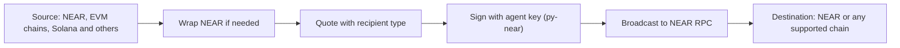

- Automatic `wrap.near` handling and `storage_deposit` when the recipient is not registered.
- Native NEAR Intents limit orders for the trader.
- Per-user multichain source and destination settings.
- Mainnet and testnet are both supported, with per-network RPC lists, token maps and intents contracts.

---

## Tech Stack

### Backend

| Component | Technology |
|-----------|-----------|
| API | FastAPI, Uvicorn |
| LLM | NEAR AI Cloud, `z-ai/glm-5.3-flash`, raw HTTPS client (LangChain only for message and tool schemas) |
| Database | Turso libSQL (production), SQLite WAL (local) |
| Scheduler | APScheduler, 30 s and 300 s pollers |
| On-chain | py-near, NEAR JSON-RPC, FastNEAR, Defuse 1-Click, Hyperliquid |
| Crypto | `cryptography` (AES-GCM, Fernet, HKDF), PyNaCl, `eth_account` |
| Streaming | NDJSON |
| Crawling | `requests`, BeautifulSoup, thread pools |
| Email | SMTP |
| Rate limiting | slowapi |

### Frontend

| Component | Technology |
|-----------|-----------|
| Framework | Next.js 16, React 19, TypeScript |
| Styling | Tailwind CSS 4, shadcn/ui, Radix UI |
| Wallets | HOT Kit (NEAR, EVM, Solana, TON), Flow FCL |
| Charts | lightweight-charts, Recharts |
| Data | SWR |
| Deployment | Vercel |

---

## Quick Start

### Backend

```bash
cd ai-agent-backend
python -m venv venv
venv\Scripts\activate   # Windows
pip install -r requirements.txt
cp .env.example .env
```

Fill in `ai-agent-backend/.env`. The important variables:

```env
NEAR_AI_API_KEY=
NEAR_AI_MODEL=z-ai/glm-5.3-flash
AGENT_ENCRYPTION_KEY=          # required: encrypts agent keys
FERNET_MASTER_KEY=             # required on hosted deployments
ONECLICK_JWT=                  # Defuse 1-Click partner key
ADMIN_WIPE_TOKEN=              # change from the default
NEAR_NETWORK=mainnet           # or testnet

# Persistence (optional locally)
TURSO_DATABASE_URL=
TURSO_AUTH_TOKEN=

# Scheduling
RUN_SCHEDULER=1
FREQUENT_POLL_SECONDS=30
LAZY_POLL_SECONDS=300

# Marketplace
MARKETPLACE_TOKEN_CONTRACT=usdt.tether-token.near
MARKETPLACE_ORDER_TTL_HOURS=24

# Optional
TWITTER_BEARER_TOKEN=
SMTP_HOST=smtp.gmail.com
SMTP_PORT=587
SMTP_USER=
SMTP_PASSWORD=
```

```bash
uvicorn main:app --reload
```

The backend starts at `http://127.0.0.1:8000`.

### Frontend

```bash
cd NeptuneAI_V2
npm install
```

Create `NeptuneAI_V2/.env.local`:

```env
BACKEND_URL=http://127.0.0.1:8000
```

```bash
npm run dev
```

Open `http://localhost:3000`.

---

## Testing

The backend test suite is in `ai-agent-backend/tests` and runs with pytest. It covers:

- Agents: rebalancer, trader judge and council guard, research crawl stream and sub-agent, per-coin sentiment, trader math and chain of thought, screener parsing, Hyperliquid.
- Watchdog: drift consistency, Ask Moderator.
- Chat: agent control, history, persistence.
- Wallets and keys: wallet manager, validator, encryption, agent metrics and sources.
- Marketplace: API, end to end, lifecycle, USDT verification.
- Platform: scheduler persistence, run hold and pollers, Turso libSQL, DB-only storage, wallet isolation, admin wipe, network checks.

Tests set `NEPTUNE_DISABLE_TURSO` so they never touch the real cloud database. Tests that call the LLM are slow.

```bash
cd ai-agent-backend
pytest tests -q
```

---

## Future Scope

### Marketplace as NFTs

Agents become NFTs. A listing is minted as an NFT that represents the agent configuration, so ownership, resale and creator royalties are on-chain instead of a database row. Buyers can verify provenance and sellers earn on every resale.

### Smart contract agents, no stored private keys

Today the backend holds an encrypted key for each agent wallet. Even encrypted, that is a trust requirement. The plan is to replace it with a smart contract account:

- The agent gets a contract that holds the funds.
- The contract grants the agent full operating access only inside limits that the user sets: spend caps, allowed tokens, allowed venues and time windows.
- The agent cannot move funds outside those limits, and the user can revoke it at any time on-chain.
- No user or agent private keys are stored in the database.

### Trader

- More indicators, including a heat map view.
- Futures and options trading.
- Leverage with on-chain enforced risk limits.

### Neptune Intents usage history

A public, dedicated history page where anyone can see how many trades and transactions have been completed through the Neptune platform, with totals and per-agent breakdowns.

### Researcher

- Broader source coverage and more default sources per ecosystem.
- Embedding based retrieval to complement keyword ranking.
- Live on-chain data modules beyond the NEAR RPC snapshot.
- Priced agent-to-agent hiring with on-chain settlement.

---

## Repository Structure

```
N-agent/
├── ai-agent-backend/
│   ├── main.py                       # FastAPI app, all routes, schedulers, run streaming
│   ├── agents.py, orchestrator.py    # Chat routing and compound queries
│   ├── agent_tools.py                # Swap and transfer tools
│   ├── market_agent_tools.py         # Fleet control tools
│   ├── flow_agent_tools.py, flow_tools.py, flow_prompts.py
│   ├── glm_transport.py              # LLM client
│   ├── marketplace_router.py         # Marketplace endpoints
│   ├── marketplace_service.py        # Listings, orders, apply
│   ├── marketplace_verify.py         # On-chain USDT payment verification
│   ├── agent_signer.py, key_manager.py  # Agent wallet keys and signing
│   ├── agent_metrics.py              # Fleet metrics, listing analytics, chat snapshot
│   ├── moderator_ask.py              # Ask the Moderator
│   ├── notification_agent.py, email_service.py
│   ├── coin_scanner.py               # Token universe scanner
│   ├── trader_mcp.py                 # Deterministic trading math
│   ├── trading_book_rag.py           # XML trading book retrieval
│   ├── market_sentiment.py, market_intelligence.py, pattern_recognition.py
│   ├── chart_visualizer.py
│   ├── network_config.py             # Mainnet and testnet configuration
││   ├── autonomous_agents/
│   │   ├── research_agent.py, research_crawler_tool.py, default_sources.json
│   │   ├── trader_agent.py, trading_pipeline.py, llm_council_judge.py
│   │   ├── hyperliquid_adapter.py, hl_funding.py
│   │   ├── rebalancer_agent.py
│   │   ├── moderator_agent.py, moderator_nodes.py
│   │   └── near_submitter.py         # Broadcast and receipt validation
│   ├── scrapper/scrapper.py          # Crawler and chunk index
│   ├── database/                     # connection, dal, schema, encryption, crypto
│   ├── knowledge_base/               # Trading book and reference data
│   ├── docs/DATABASE_ARCHITECTURE.md
│   └── tests/
└── NeptuneAI_V2/
    ├── app/                          # Pages and API proxy routes
    ├── components/
    │   ├── chat-interface.tsx, client-app.tsx
    │   ├── agent-marketplace.tsx, share-agent-modal.tsx, listing-analytics-modal.tsx
    │   ├── agent-wallet-manager-modal.tsx, hyperliquid-settings.tsx
    │   ├── agent-sections/           # trader, rebalancer, research, moderator
    │   ├── dashboard/                # beginner, trader, command center, risk
    │   └── market/                   # order flow, charts, watchlist
    ├── providers/                    # HOT Kit and Flow wallet providers
    └── lib/                          # network, market data, agent config
```

---

Neptune AI Team, NEAR Hackathon 2026.
